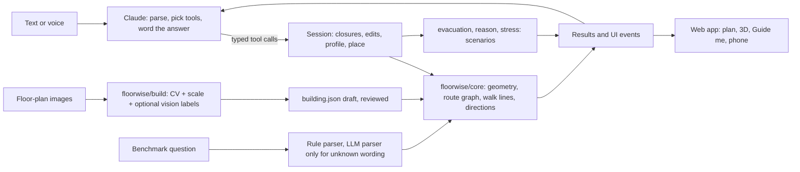

# Floorwise: talk to your building

Floorwise is an indoor navigation agent for Synera Track 01 ("Talk to your building") at the Industrial Agents Hackathon 2026. Load a building model, or rebuild one from floor-plan images. Then anyone can ask it, by text or by voice, where things are, how to get somewhere (step-free, avoiding places, several stops), and what changes when a lift closes or a door is added. It answers in words, on a 2D plan and in a 3D model of the building, and can walk you through the route.

**The one design rule: every fact comes from deterministic code.** The language model (Claude) reads the request, picks typed tools and words the answer. Distances, areas, counts, routes, closures and evacuation times all come from `floorwise/core` and the solvers, which contain no model calls. The reasons are recorded in [ADR 001](docs/adr/001-deterministic-facts.md) and the [research summary](reports/Indoor%20wayfinding%20agent%20UX.md).

## For judges

| What | Where |
|---|---|
| Public test answers (the required package) | [`SUBMISSION/answers.json`](SUBMISSION/answers.json) and [`SUBMISSION/BENCHMARK.md`](SUBMISSION/BENCHMARK.md) |
| The kit's CSV format (`question_id,answer`) | [`submissions/team_floorwise_test.csv`](submissions/team_floorwise_test.csv) |
| Run on any building (the "Sunday" command) | `uv run run_benchmark <building_dir> <questions.json\|.jsonl\|.csv> <answers.json\|.csv>` ([BENCHMARK.md](BENCHMARK.md)) |
| Rebuild and validate the package | `uv run fw submit` ([`floorwise/submission.py`](floorwise/submission.py)) |
| Evidence for each capability | [docs/JUDGING.md](docs/JUDGING.md), current state in [docs/STATUS.md](docs/STATUS.md) |
| Two-minute demo script | [docs/DEMO.md](docs/DEMO.md) |

The public test set has no gold answers, so the 145 test answers are predictions. The evidence is the labelled train/dev data and the independent route checks below.

## What it does

| Capability | How | Code |
|---|---|---|
| Find rooms and equipment | Fuzzy entity linking over names, room numbers, room types and item types. It asks back when a name fits several rooms. | [`core/resolve.py`](floorwise/core/resolve.py), [`agent/tools.py`](floorwise/agent/tools.py) |
| Exact routes | The kit 1.1.0 route model: door to door inside each space, 15 cm off the walls; stairs cost 2 m per metre climbed; a lift costs 15 m per ride plus 1 m per metre climbed; no route round the outside | [`core/spacewalk.py`](floorwise/core/spacewalk.py), [`core/graph.py`](floorwise/core/graph.py) |
| Route constraints | Step-free, minimum door width, closed places, avoid and soft-avoid, forklift rules, production bays as destinations only, tours | `Constraints` in [`core/graph.py`](floorwise/core/graph.py), [`core/routing.py`](floorwise/core/routing.py) |
| Directions a person can follow | Decision points, landmarks, each floor change as its own step, a short spoken overview | [`core/instructions.py`](floorwise/core/instructions.py) |
| Walking line you can see | A taut string around furniture inside each room. Previews that would cross a wall or furniture are withheld, not drawn. | [`core/walk.py`](floorwise/core/walk.py), [`core/preview_check.py`](floorwise/core/preview_check.py) |
| Edits with undo | Add, remove and widen doors; close and reopen places; add, move and remove items. Routes are recomputed on the edited model. | [`agent/session.py`](floorwise/agent/session.py), [`tests/test_edit_capabilities.py`](tests/test_edit_capabilities.py) |
| Closure impact and weak points | Which rooms lose exit access when one element closes, for everyone, for step-free users and for a 1.1 m trolley. Fixes are checked by re-running the analysis on the edited building. | [`core/resilience.py`](floorwise/core/resilience.py), [`core/fixes.py`](floorwise/core/fixes.py) |
| Fire and evacuation scenarios | An exact quickest evacuation (time-expanded flow, minimum cut), a responder route that avoids evacuees, and door changes that are re-solved before they are offered | [`floorwise/evacuation/`](floorwise/evacuation), [`floorwise/reason/`](floorwise/reason) |
| Evacuation stress test | Per-person queue simulation on the same route graph as navigation, with door flow, pre-movement delay and walking speed spread | [`floorwise/stress/sim.py`](floorwise/stress/sim.py) |
| Build from floor plans | OpenCV regions, doors and entrances from plan images, one real dimension for scale, optional Claude vision labels. The result is a draft that a person reviews. | [`floorwise/build/`](floorwise/build), [ADR 003](docs/adr/003-reconstruction-is-a-draft.md) |
| Between buildings | Picks the best exit and entrance pair across 17 OpenStreetMap buildings that have real coordinates, with an outdoor leg | [`core/campus.py`](floorwise/core/campus.py), [`server/georef.py`](server/georef.py) |
| Voice | ElevenLabs speech-to-text and text-to-speech through the server, so the key never reaches the browser. The browser's own speech is the fallback. One speaker at a time. | [`server/voice.py`](server/voice.py), [`web/src/lib/speaker.ts`](web/src/lib/speaker.ts) |
| Phone, AR and VR | Pair a phone by QR code as a remote and instruction display (`/phone`); WebXR AR route ribbon on Android Chrome; VR Guide me on a headset | [`server/companion.py`](server/companion.py), [`web/src/companion/`](web/src/companion), [`web/src/components/VrRig.tsx`](web/src/components/VrRig.tsx) |
| Benchmark Lab | `/lab`: runs, failures with the route drawn on the plan, comparisons, readiness by grading group | [`server/lab.py`](server/lab.py), [`web/src/lab/`](web/src/lab) |

The chat agent works through more than 30 typed tools (for example `find_route`, `set_closed`, `rank_rooms_by_items`, `plan_scenario`, `ask_choice`). A tool error comes back with candidate matches, so the model asks the person instead of guessing.

## Architecture



- **Benchmark path:** question text, then the rule parser ([`agent/parse_rules.py`](floorwise/agent/parse_rules.py)), then the solver ([`agent/solve.py`](floorwise/agent/solve.py)), then an answer ending in `Answer: ...`. The test package was generated with zero LLM calls; an LLM parser ([`agent/parse_llm.py`](floorwise/agent/parse_llm.py)) handles wording the rules do not know.
- **Three meanings of "distance"**, kept apart on purpose ([ADR 002](docs/adr/002-three-routing-semantics.md)): the official benchmark route cost, the walking line drawn for a person, and exit-rooted impact analysis.
- **Provider layer:** [`floorwise/llm/`](floorwise/llm) runs the same tool loop on Anthropic (production) or an OpenAI-compatible provider (Groq, OpenRouter) for testing. Default Claude models: `claude-sonnet-5-5` for chat, `claude-haiku-5-5` for the parser, `claude-opus-5-5` for vision labels and eval judging. Each role can be overridden with `FLOORWISE_<ROLE>_MODEL`.

Full description: [docs/ARCHITECTURE.md](docs/ARCHITECTURE.md).

## Results

All of the gates below run offline, with no API key. The numbers are from the last full gate run (25 October 2026, unchanged source tree). Reproduce them with `uv run fw check`.

| Gate | What it checks | Result |
|---|---|---|
| `routes` | Our route model against the 2,130 warm-up route answers, to the centimetre | 2130/2130 |
| `solver` | Gold inputs to answers, train + dev | 655/655 |
| `parser` | Question text to resolved ids: train + dev, test coverage | 655/655, 145/145 |
| `e2e` | The full pipeline from question text, train + dev | 653/655 (2 known) |
| Kit evaluator | `benchmark.evaluate` from the kit on dev, run on 25 October 2026 | **138/138** |
| `e2e_basic` | Locate, count, route, step-free, closure and tour questions from text | 2122/2130 (8 known) |
| `sunday` | Routes scored the way the judges describe, measured by the kit's own router | 1329/1338 (9 known) |
| `generated`, `rules`, `roundtrip` | New questions on any building, every route rule as a property, new wording round trips | 150/150, 661/661, 236/236 |
| `differential` | Our graph against the kit's `building_map.py`, edge for edge, plus routes under closures | 256/256 (8,960/8,960 on all 280 buildings) |
| `walls`, `walkability`, `edits` | Previews never cross walls; furniture clearance; routes after each edit equal the kit's | 160/160, 160/160, 72/72 |
| `robust`, `metamorphic`, `gold` | Reworded questions; translate, rotate and shuffle invariance; five rephrasings of every question (plus a hash holdout) | 630/630, 860/860, 3755/3755 + 1530/1530 |

"Known" misses are listed one by one, with a diagnosis, in [`eval/known_issues.json`](eval/known_issues.json): OpenStreetMap buildings where, for example, 9 offices on one floor are all named "Büro" and the question gives no room number. The gates fail on any other miss, whatever the percentage.

Evacuation, measured with `uv run python -m eval.ccrp_gap 40` (one fire per building, 40 sampled train/dev buildings, run on 25 October 2026): in 26 of the 27 scenarios where everyone gets out, the exact plan takes the same time as the classic CCRP heuristic; in the other it is 4.2 % faster. So the value is not raw speed. The plan names the doors that limit the evacuation, keeps a responder route free, and finds a door change that passes re-solving in 9 of 40 buildings (median 10 % faster, best 14 %). For the other 31 it says that no door change helps.

Tests: 567 Python tests (`uv run python -m pytest -q`) and 39 Playwright spec files for desktop and phone viewports (`uv run fw ui-test`). Details: [docs/TESTING.md](docs/TESTING.md).

## Quick start

You need [uv](https://docs.astral.sh/uv/), Node 22 and the kit data in `docs/industrial-agents-hackathon-2026` (gitignored), or set `FLOORWISE_KIT` to point to it.

```bash
uv sync
cp .env.example .env                          # ANTHROPIC_API_KEY=... (voice and outdoor routing keys are optional)
cd web && npm install && npm run build && cd ..
uv run fw doctor                              # checks keys, data and the web build
uv run --env-file .env uvicorn server.app:app --port 8000    # or: uv run fw start
```

Open http://localhost:8000. Other entry points:

| Command | What |
|---|---|
| `uv run fw dev` | Backend with reload on :8000, Vite on :5173 |
| `uv run fw start --lan` | Same app for a phone on the local network ([docs/PHONE_DEMO.md](docs/PHONE_DEMO.md)) |
| `uv run fw chat [building_dir]` | Talk to a building in the terminal |
| `uv run fw check` | All Python tests, then every offline gate |
| `uv run fw ui-test` | Builds the web app, starts a server, runs Playwright |
| `uv run fw eval <suite>` | One eval suite (`uv run python -m eval` lists them) |
| `uv run python -m floorwise.build.builder buildings/new --floor 0=plan0.png --width 55.5 [--vision]` | Rebuild a building from plan images |

Useful URLs: `/?building=<id>`, `/?building=<id>&at=<space id>&to=<name>` (open a route directly), `/?demo=fire` (the narrated fire scenario), `/lab`, `/map`, `/phone`.

Hosting the app for others is described in [docs/DEPLOY.md](docs/DEPLOY.md).

## Limitations

- **Plan import is a draft.** On the 40-building dev set (122 floors), 64 floors pass the strict import geometry and topology check, and no complete building passes automatically. All 45 procedural floors pass; real OpenStreetMap, ResPlan and Swiss plans are much weaker. See [docs/RECONSTRUCTION_VALIDATION_RESULTS.md](docs/RECONSTRUCTION_VALIDATION_RESULTS.md).
- **Evacuation is a pre-screen, not a fire model.** There is no smoke or fire spread. Occupancy and passage rates are explicit inputs or labelled estimates from seat counts. "Verified" fixes are self-consistency: the same engine re-solves the edited building. Nothing is validated against Pathfinder, a real drill, or building codes.
- **Not tried on hardware.** Phone pairing has run in two browser contexts on one machine. AR, VR and real microphone and speaker quality have not been tried on physical devices.
- **3D is schematic.** Walls, stair flights and furniture models are illustrative. At a floor change, Guide me shows a short stairs or lift overlay. It does not animate a walk up a flight that the data does not describe.
- **Live LLM quality is measured, not guaranteed.** The 30-conversation live pack last scored 25/30 (three wording failures, two incomplete on budget). Model wording is checked by an LLM judge, not by people.
- **Position is declared, not tracked.** The start is the main entrance, a tapped room, or a QR deep link. There is no BLE, Wi-Fi or camera positioning.

Open work is tracked in [docs/TASKLIST.md](docs/TASKLIST.md) and [docs/BACKLOG.md](docs/BACKLOG.md).

## Repository map

```
floorwise/core        building model, route graph (kit 1.1.0 rules), geometry, walking lines, directions, resilience, scene compile
floorwise/agent       QuerySpec, rule and LLM parsers, solver, benchmark answer(), Session, chat agent and tools
floorwise/llm         provider-neutral tool loop, structured output, token budget
floorwise/build       floor-plan images to building.json (CV, learned palette, optional vision labels)
floorwise/evacuation  exact evacuation as flow over time, responders, door synthesis, CCRP baseline
floorwise/reason      multi-hop scenario plans: typed operators, per-step checks, findings
floorwise/stress      per-person evacuation queue simulation on the navigation graph
floorwise/cli.py      run_benchmark (the Sunday command); fw.py is the project CLI
server/               FastAPI: sessions, routes, edits, SSE chat, scenarios, voice, phone relay, Lab
web/                  React + Vite + three.js: Navigator, 3D scene, Guide me, phone companion, Lab
eval/                 eval suites, ledger, gates, known-issues list
tests/                pytest suite
docs/                 documentation (start at docs/README.md); the kit lives in docs/industrial-agents-hackathon-2026
SUBMISSION/, submissions/   the benchmark package and the kit's CSV
```

Contributors and coding agents: read [AGENTS.md](AGENTS.md) first.

## Licences

The building data comes from the hackathon kit. OSM-derived buildings are ODbL 1.0 (© OpenStreetMap contributors). Swiss Dwellings and ResPlan are CC BY 4.0. Procedural buildings are CC0. See the kit's `ATTRIBUTION.md`.
